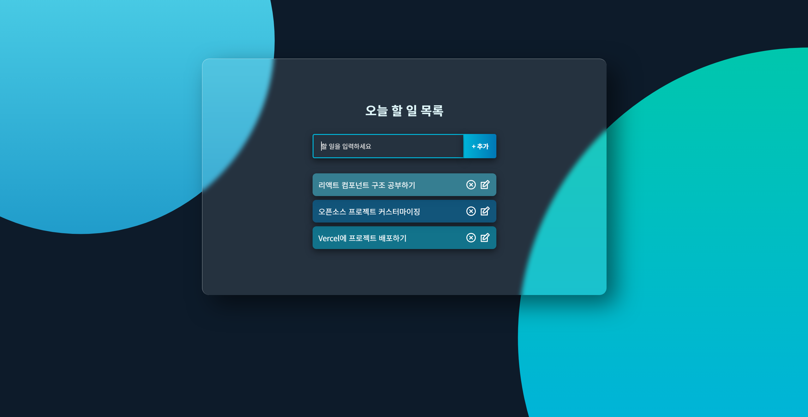

# React Todo List

## Project Information

**원본 GitHub URL:** https://github.com/mmeii/react-todo-list  
**라이선스:** MIT License (Copyright © Mengmei Tu)

### 프로젝트 소개

할 일을 추가, 수정, 삭제하고 완료 여부를 관리할 수 있는 간단한 Todo List 웹 애플리케이션이다. React를 사용해 제작되었으며, 별도의 서버나 데이터베이스 없이 브라우저의 localStorage에 데이터를 저장한다.

### 선택 이유

React의 기본 개념인 컴포넌트 분리, useState와 useEffect 훅, props 전달 방식을 하나의 프로젝트에서 확인할 수 있어 선택했다. 코드 규모가 크지 않아 전체 구조를 파악하기 쉽고, CRUD 기능이 모두 구현되어 있어 React의 상태 관리 방식과 데이터 흐름을 이해하는 데 적합하다고 판단했다.

### 주요 기능

1. **할 일 추가** - 입력창에 내용을 입력하고 추가 버튼을 누르면 목록에 새로운 항목이 추가된다.
2. **할 일 수정 및 삭제** - 각 항목에 있는 아이콘을 통해 내용을 수정하거나 삭제할 수 있다.
3. **완료 표시** - 할 일 항목을 클릭하면 취소선이 표시되며 완료 상태로 변경된다. 변경된 데이터는 localStorage에 저장되어 새로고침 후에도 유지된다.

---

## Installation

### 실행 환경

- Node.js 14 이상
- npm 6 이상

### 설치 및 실행 방법

git clone https://github.com/mmeii/react-todo-list.git
cd react-todo-list
npm install
npm start

브라우저에서 http://localhost:3000 에 접속하면 실행 화면을 확인할 수 있다.

### 실행 화면

---

## Source Code Exploration

### Project Structure: 주요 파일

- **src/App.js** : 앱의 최상위 컴포넌트다. TodoList 컴포넌트를 불러와 화면에 렌더링하고 App.css를 적용한다.
- **src/components/TodoList.js** : 할 일 목록의 상태를 관리하는 핵심 컴포넌트다. 할 일 추가(addTodo), 수정(updateTodo), 삭제(removeTodo), 완료(completeTodo) 함수를 가지고 있으며, localStorage와의 데이터 연동도 담당한다.
- **src/App.css** : 앱 전체의 스타일을 담당하는 파일이다. 배경 그라데이션, 글라스모피즘 카드, 입력창, 버튼, 할 일 목록의 색상과 레이아웃 등을 정의한다.

### React Component: 주요 컴포넌트

**TodoList.js**

할 일 목록 전체의 상태를 관리하는 컴포넌트다. useState를 사용해 todos 배열을 관리하며, 두 개의 useEffect를 사용해 localStorage에서 데이터를 불러오고 변경된 데이터를 저장한다. 또한 CRUD 기능을 수행하는 함수들을 하위 컴포넌트인 TodoForm과 Todo에 props로 전달한다.

**Todo.js**

할 일 목록을 화면에 표시하는 컴포넌트다. 수정 중인 항목이 있으면 TodoForm을 편집 모드로 보여주고 그렇지 않으면 todos 배열을 map으로 순회하며 각 항목을 화면에 출력한다.

### Code Analysis

첫 번째 useEffect는 의존성 배열이 빈 배열([])이므로 컴포넌트가 처음 화면에 나타날 때 실행된다. localStorage에 저장된 데이터가 있으면 해당 데이터를 불러오고, 데이터가 없으면 미리 정의한 샘플 데이터를 사용한다.

두 번째 useEffect는 의존성 배열에 todos가 들어 있어 todos의 값이 변경될 때마다 실행된다. 변경된 할 일 목록을 JSON 문자열로 변환해 localStorage에 저장한다.

두 useEffect가 각각 데이터를 불러오는 역할과 저장하는 역할을 나누어 수행하기 때문에 새로고침 후에도 기존 데이터를 유지할 수 있다.

---

## Customizing

### 1. Text 변경 - src/components/TodoList.js, src/components/TodoForm.js

| 위치 | 변경 전 | 변경 후 |
|------|---------|---------|
| h1 제목 (TodoList.js) | What's the Plan for Today? | 오늘 할 일 목록 |
| 입력창 placeholder (TodoForm.js) | Add a todo | 할 일을 입력하세요 |
| 추가 버튼 (TodoForm.js) | Add todo | + 추가 |
| 수정 입력창 placeholder (TodoForm.js) | Update your item | 수정할 내용을 입력하세요 |
| 수정 버튼 (TodoForm.js) | Update | 수정 완료 |

기존 영어 문구를 한국어로 변경해 어떤 기능을 하는 앱인지 쉽게 알 수 있도록 수정했다.

### 2. Style 변경 - src/App.css

| 항목 | 변경 전 | 변경 후 |
|------|---------|---------|
| 배경색 | #161623 (어두운 남색) | #0d1b2a (짙은 네이비) |
| 배경 그라데이션 장식 | 빨강, 핑크, 파랑 계열 | 청록, 하늘색, 파랑 계열 |
| 글꼴 | PT Sans | Noto Sans KR, Segoe UI |
| h1 폰트 크기 | 24px | 26px |
| h1 색상 | #fff | #e0f7fa |
| 버튼 그라데이션 | 보라색 → 자주색 | 청록색 → 파란색 |
| 할 일 행 배경 색상 | 주황, 보라, 분홍, 파랑 | 파랑, 청록, 하늘색 계열 |
| 아이콘 호버 색상 | #a882f3 (연보라) | #80deea (연청록) |

기존의 빨강과 보라 계열을 청록색과 파란색 계열로 변경해 전체적인 색상을 통일했다.

### 3. UI/Data 변경 - src/components/TodoList.js, src/App.css

**기본 샘플 데이터 추가**

기존에는 처음 실행했을 때 할 일 목록이 비어 있었다. initialTodos 배열에 샘플 데이터 3개를 추가했다. localStorage에 저장된 데이터가 없을 때만 샘플 데이터가 표시되도록 수정했다.

**완료된 항목 삭제 버튼 추가**

완료 상태인 항목이 하나라도 있으면 목록 하단에 완료된 항목 삭제 버튼이 나타나도록 추가했다. 버튼을 누르면 완료된 항목만 한 번에 삭제된다. 완료된 항목이 없으면 버튼도 표시되지 않는다.

변경 전: 목록 아래에 별도의 기능이 없다.
변경 후: 완료된 항목이 존재하면 목록 하단에 완료된 항목 삭제 버튼이 표시된다.

---

## Deployment

**Vercel 배포 URL:** https://react-todo-list-jin030121.vercel.app

GitHub Repository를 Vercel에 연결해 배포했다. 이후 GitHub에 변경 사항을 Push하면 Vercel에서 자동으로 다시 배포되는 방식이다.

---

## Weekly Review

### 새롭게 배운 내용 3가지

1. **useEffect의 의존성 배열 동작 방식**

   useEffect의 의존성 배열에 빈 배열([])을 넣으면 컴포넌트가 처음 마운트될 때 실행되고, 특정 값을 넣으면 해당 값이 변경될 때마다 실행된다는 것을 알게 되었다. TodoList에 있는 두 개의 useEffect가 서로 다른 역할을 수행하며 localStorage와 데이터를 주고받는 방식이 인상적이었다.

2. **컴포넌트 간 props 전달 구조**

   todos 상태는 TodoList에서 관리하고, 하위 컴포넌트인 Todo와 TodoForm은 필요한 데이터와 함수를 props로 전달받아 사용한다는 것을 이해했다. 상태를 한 곳에서 관리하고 필요한 기능을 하위 컴포넌트에 전달하는 구조를 통해 React의 단방향 데이터 흐름을 확인할 수 있었다.

3. **CSS clip-path를 이용한 배경 장식 기법**

   body::before와 body::after 가상 요소에 clip-path: circle()을 적용해 원형 그라데이션 배경을 만드는 방식을 새롭게 알게 되었다. 별도의 이미지 파일을 사용하지 않고 CSS만으로도 배경에 다양한 디자인 요소를 추가할 수 있다는 점이 흥미로웠다.

### 어려웠던 점과 해결 방법

**어려웠던 점**

localStorage에서 데이터를 불러올 때 기본 샘플 데이터를 어떻게 적용해야 할지 고민했다. 처음에는 setTodos(initialTodos)를 기본값으로 설정하면 된다고 생각했지만, 이렇게 하면 기존에 사용자가 추가한 데이터가 유지되지 않을 수 있다는 문제가 있었다.

**해결 방법**

useEffect 안에서 먼저 localStorage에 저장된 데이터가 있는지 확인하도록 수정했다. 저장된 데이터가 있으면 해당 데이터를 사용하고, 데이터가 없을 때만 initialTodos를 적용하도록 조건문을 추가했다.

### AI 활용 내용 및 느낀 점

이번 프로젝트를 진행하면서 AI가 코드를 수정해 주더라도 그 코드가 어떤 원리로 동작하는지 이해하는 과정이 중요하다는 것을 느꼈다. 특히 useEffect가 두 개로 나누어져 있는 이유와 각각의 역할을 직접 코드를 읽으며 이해한 것이 가장 도움이 되었다.

---

## License

Copyright (c) Mengmei Tu. All rights reserved.  
Licensed under the [MIT](LICENSE) license.
